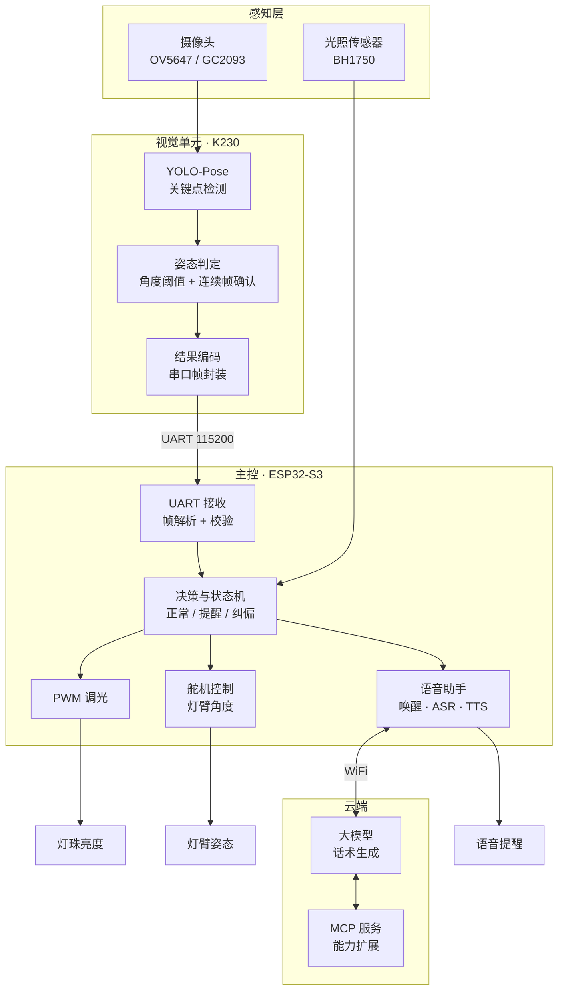

<div align="center" id="top">

# 星眸智能护眼仪 StarMou

**坐姿识别 · 语音提醒 · 自适应调光 —— 一台会"看着你"的护眼台灯**

基于 **K230 视觉姿态识别 + ESP32-S3 语音交互** 的双芯片方案，
把模糊的"护眼"需求拆解成可验证的闭环：**识别 → 提醒 → 调光**

[](https://www.canaan-creative.com/)
[](https://www.espressif.com/)
[](https://modelcontextprotocol.io/)
[](#-团队与分工)
[](LICENSE)

[项目简介](#-项目简介) · [系统架构](#-系统架构) · [硬件清单](#-硬件清单) · [快速开始](#-快速开始) · [串口协议](#-串口通信协议) · [常见问题](#-常见问题)

</div>

---

## 📌 项目简介

### 要解决什么

青少年长时间伏案，家长不在身边时没人提醒。市面上的护眼台灯**只解决了"光"的问题**（调亮度、调色温），却看不到**"人"的姿势**——而近视和脊柱问题，恰恰主要来自长期低头、前倾、驼背。

### 我们的做法

| 能力 | 实现 | 效果 |
|---|---|---|
| **看得见** | K230 端运行 YOLO-Pose 关键点检测，本地实时推理 | 识别低头 / 颈部前倾 / 驼背，画面不上云 |
| **会提醒** | ESP32-S3 语音助手，TTS 播报 + 云端大模型生成自然话术 | 不用屏幕，直接开口提醒 |
| **能调光** | 光照传感器 + PWM 无级调光，舵机调节灯臂角度 | 按环境亮度自动补光，照射角度跟着坐姿走 |
| **可闭环** | 识别 → 判断 → 提醒 → 调光 → 再次识别 | 不是一次性告警，而是持续纠偏 |

> **设计原则**：视觉在端侧（隐私 + 低延迟）、语音与语义在云端（自然 + 可扩展）、控制在本地（断网也能调光）。

---

## 🏗️ 系统架构



### 为什么是双芯片

| | K230 | ESP32-S3 |
|---|---|---|
| 承担 | 视觉推理（算力密集） | 控制 + 语音 + 联网（IO 密集） |
| 理由 | 自带 KPU，能跑 `.kmodel` 量化模型，实时性够 | WiFi/BT 原生、外设丰富、功耗低、语音生态成熟 |
| 不做对方的事 | 不接网络、不做控制 | 不跑视觉、不处理图像 |

**这样分工的好处**：视觉端不联网 → 图像数据不出设备；主控端不跑模型 → 语音和控制不被推理卡住。

### 数据流

```text
摄像头 → K230 推理 → 17 个关键点 → 计算颈角/背角
      → 连续 N 帧超标? → 是 → UART 发送 {类别, 角度, 置信度}
                                    ↓
      ESP32-S3 校验 → 状态机判断（是否冷却期/是否已提醒）
                                    ↓
              ├→ TTS 语音提醒（"坐直一点哦"）
              ├→ PWM 调整亮度（补光）
              └→ 舵机微调灯臂（改善照射角度）
```

---

## 🧠 坐姿判定逻辑

### 关键点选取

基于 YOLO-Pose 输出的 17 个关键点，只用其中 5 个，减少噪声：

| 部位 | 关键点 | 用途 |
|---|---|---|
| 鼻 / 眼 / 耳 | Nose, L/R-Eye, L/R-Ear | 计算**低头角度**（头部前倾） |
| 肩 | L/R-Shoulder | 计算**驼背角度**（背部弯曲） |
| 髋 | L/R-Hip | 作为躯干基准线 |

### 三个判定维度

| 判定项 | 几何定义 | 触发条件 | 提醒话术方向 |
|---|---|---|---|
| **低头** | 耳—眼连线与水平线夹角 | 超过阈值并持续 | "头抬一点，脖子会累" |
| **颈部前倾** | 耳—肩连线与竖直方向夹角 | 超过阈值并持续 | "离桌子太近啦" |
| **驼背** | 肩—髋连线与竖直方向夹角 | 超过阈值并持续 | "背挺直一些" |

### 抗抖动设计

单点角度容易因为一帧的误检就误报，所以加了三层过滤：

1. **置信度过滤**：关键点置信度低于阈值的关键帧直接丢弃
2. **连续帧确认**：连续 **N 帧**（默认 30 帧，约 1–2 秒）均超标才判定为真
3. **冷却期**：一次提醒后进入冷却期（默认 30 秒），避免反复打扰

```python
# 伪代码：连续帧确认 + 冷却期
if angle > THRESHOLD:
    bad_frame_count += 1
    if bad_frame_count >= N_FRAMES and time_since_last_remind > COOLDOWN:
        send_uart(POSTURE_BAD, angle)
        time_since_last_remind = now
        bad_frame_count = 0
else:
    bad_frame_count = max(0, bad_frame_count - 1)   # 缓慢回落，避免频繁横跳
```

> ⚠️ **阈值必须自己标定**：角度阈值与摄像头的安装高度、俯仰角强相关，上面给的是**建议起点**，请按 `tools/calibrate.py`（自建）实测标定后填入 `config.h`。

---

## 🧰 硬件清单

| 类别 | 器件 | 推荐型号 | 数量 | 用途 |
|---|---|---|---|---|
| 视觉 | 视觉开发板 | 勘智 **K230**（CanMV-K230） | 1 | 姿态推理 |
| 视觉 | 摄像头 | OV5647 / GC2093（MIPI CSI） | 1 | 采集坐姿画面 |
| 主控 | MCU | **ESP32-S3**（建议 N8R8，带 PSRAM） | 1 | 控制 + 语音 + 联网 |
| 音频 | 麦克风 | INMP441（I2S） | 1 | 语音输入 |
| 音频 | 功放 + 喇叭 | MAX98357A + 4Ω 3W | 1 | TTS 播报 |
| 光照 | 光照传感器 | BH1750（I2C）或光敏电阻 + ADC | 1 | 环境亮度采集 |
| 光源 | 灯珠 / 灯板 | 高显色 LED（Ra ≥ 95，建议 4000K） | 1 | 主照明 |
| 驱动 | 舵机 | MG996R / SG90 | 1–2 | 灯臂角度调节 |
| 电源 | 电池 | 3.7V 锂电池 + 充放电模块 | 1 | 便携供电 |
| 结构 | 灯臂 / 底座 | 3D 打印件或现成台灯改装 | 1 套 | 结构支撑 |
| 其它 | 导线、Type-C 充电口、拨动开关、外壳 | — | 若干 | 装配 |

> 💡 **关于 LED**：护眼的核心是**高显色 + 无频闪 + 合适色温**，选型时优先看 `Ra` 和频闪指标，而不是单纯追求亮度。

---

## 🔌 接线参考

### K230 ↔ ESP32-S3（UART）

```text
K230              ESP32-S3
GPIO  (TX)  ---->  GPIO17 (RX2)
GPIO  (RX)  <----  GPIO18 (TX2)
GND         ----   GND          # 必须共地，否则数据乱码
```

### ESP32-S3 外设

| 外设 | 接口 | 引脚（示例） |
|---|---|---|
| 麦克风 INMP441 | I2S | BCLK=GPIO4, WS=GPIO5, DIN=GPIO6 |
| 功放 MAX98357A | I2S | BCLK=GPIO15, LRC=GPIO16, DOUT=GPIO7 |
| 光照 BH1750 | I2C | SDA=GPIO8, SCL=GPIO9 |
| 舵机 | PWM | GPIO10（灯臂俯仰） |
| LED 调光 | PWM | GPIO11（接 MOS 管驱动灯板） |

> ⚠️ 引脚仅为示例，请以你手上的板子和固件为准修改 `include/config.h`。ESP32-S3 的 GPIO 有部分为 Strapping 引脚，避免占用 GPIO0/GPIO3/GPIO45/GPIO46。

---

## 📡 串口通信协议

K230 与 ESP32-S3 之间走自定义帧，带帧头、长度、校验，避免串口噪声导致的误动作。

### 帧格式

| 字段 | 长度 | 值 / 说明 |
|:---:|:---:|---|
| 帧头 | 2 B | `0xAA` `0x55` |
| 类型 | 1 B | `0x01`=坐姿异常 `0x02`=坐姿正常 `0x03`=心跳 |
| 姿态类别 | 1 B | `0`=正常 `1`=低头 `2`=颈部前倾 `3`=驼背 |
| 角度 | 1 B | 0–90，单位度（超出按 90 饱和） |
| 置信度 | 1 B | 0–100 |
| 校验 | 1 B | 前面所有字节累加和取低 8 位 |
| 帧尾 | 1 B | `0x0D` |

**示例**（低头 32°，置信度 87）：

```text
AA 55 01 01 20 57 XX 0D
│  │  │  │  │  │  └─ 帧尾
│  │  │  │  │  └──── 置信度 0x57 = 87
│  │  │  │  └─────── 角度 0x20 = 32°
│  │  │  └────────── 类别 1 = 低头
│  │  └───────────── 类型 0x01 = 坐姿异常
│  └──────────────── 帧头
```

### 解析要点

- **必须校验**：校验和不匹配的帧直接丢弃，否则串口干扰会导致灯乱闪、喇叭乱叫
- **状态机接收**：按字节状态机解析（找帧头 → 收类型 → 收长度 → 校验），不要一次 `read()` 就当一帧
- **心跳机制**：K230 每 2 秒发一次 `0x03`，主控超时未收到则判定视觉端掉线，进安全状态（保持当前亮度）

---

## 🚀 快速开始

### 前置条件

- CanMV / K230 SDK（模型转换用 `nncase`）
- ESP-IDF v5.x 或 Arduino-ESP32（二选一，本项目主控代码基于 `<!-- TODO: 你实际用的框架 -->`）
- Python 3.8+（数据集处理、标注、训练）
- 语音助手固件（ESP32-S3 侧，唤醒词「小智」）

### 1️⃣ 准备数据集

```bash
# 采集：不同身高/坐姿/光照条件下的人体坐姿图像
python tools/collect.py --output data/raw --camera 0

# 标注（关键点格式）
python tools/label.py --input data/raw --output data/labels

# 增强：亮度扰动 + 水平翻转 + 轻微旋转，提升鲁棒性
python tools/augment.py --input data/labels --output data/train --times 3
```

> 💡 采集建议：覆盖**戴眼镜 / 扎头发 / 穿帽衫 / 侧光 / 背光**等场景，否则实际使用时容易误判。

### 2️⃣ 训练并导出模型

```bash
# 训练 YOLO-Pose（关键点检测）
yolo pose train data=sitting.yaml model=yolov8n-pose.pt epochs=150 imgsz=320

# 转 K230 可用的 .kmodel（nncase 量化）
python tools/to_kmodel.py --onnx best.onnx --output model/sitting_pose.kmodel --calib data/calib
```

### 3️⃣ 烧录 K230 视觉端

```bash
# 把 .kmodel 与推理脚本放到 K230
k230_deploy.sh model/sitting_pose.kmodel vision/main.py
```

### 4️⃣ 编译烧录 ESP32-S3 主控

```bash
# 修改配置：WiFi、引脚、阈值、冷却时间
vim include/config.h

idf.py build flash monitor
# 或 Arduino：选择 ESP32S3 Dev Module → Upload
```

### 5️⃣ 装配与联调

1. 先**分模块验证**：摄像头能出图 → 舵机能转 → 灯能调光 → 喇叭能响 → 串口能通
2. 再**联调整体**：把 K230 与 ESP32-S3 接好，用手故意做低头动作，观察串口日志
3. 最后**装机封装**：固定各模块位置，注意**摄像头与 K230 的排线别被灯臂运动拉扯**

> ⚠️ 焊接与装配顺序建议：先裸板调通所有功能，再装外壳。装壳后再改线非常痛苦。

---

## 📁 项目结构

```text
StarMou/
├── vision/                  # K230 视觉端
│   ├── main.py              # 主循环：采集 → 推理 → 判定 → 串口发送
│   ├── pose_model.kmodel    # 量化后的姿态模型
│   └── uart_protocol.py     # 帧封装
├── main/                    # ESP32-S3 主控
│   ├── main.c               # 入口
│   ├── uart_handler.c       # 串口接收状态机 + 校验
│   ├── posture_fsm.c        # 坐姿状态机（正常/提醒/冷却）
│   ├── pwm_light.c          # PWM 自适应调光
│   ├── servo.c              # 舵机灯臂控制
│   └── voice.c              # 语音助手接入 + TTS 播报
├── include/
│   └── config.h             # 引脚、阈值、冷却时间等集中配置
├── tools/                   # 数据集与模型工具
├── model/                   # 训练产物
├── docs/                    # 结构图、电路图、装配说明
└── README.md
```

---

## 📊 效果与测试

测试方法：自建测试集（不同人 × 不同坐姿 × 不同光照），统计识别结果与人工标注的对比。

| 指标 | 结果 | 说明 |
|---|:---:|---|
| 坐姿识别准确率 | `<!-- TODO: 填入实测值 -->` | 正/异常坐姿分类准确率 |
| 误报率 | `<!-- TODO -->` | 正常坐姿被判为异常的比例 |
| 单帧推理耗时 | `<!-- TODO -->` ms | K230 端，含前后处理 |
| 端到端提醒延迟 | `<!-- TODO -->` s | 从姿态超标到语音播报 |
| 调光响应时间 | `<!-- TODO -->` ms | 环境亮度变化到灯珠响应 |

**调优过程中最有效的三件事**：

1. 数据集里补上真实的**侧光/背光样本**（初期误报几乎都来自光照变化）
2. 加**连续帧确认**后，误报率断崖式下降
3. 角度阈值按摄像头实际安装位置**重新标定**，而不是沿用经验值

---

## 👥 团队与分工

第十九届广东省计算机设计大赛 **省赛三等奖**

| 角色 | 职责 |
|---|---|
| **队长** | 场景洞察与需求定义、方案设计、技术路线选型、团队分工与排期、代码编写与联调 |
| 队员 A | 硬件结构、整机装配与焊接、机械结构调试 |
| 队员 B | 数据采集与标注、模型训练调优、测试验证 |

---

## 🗺️ 后续计划

- [x] 视觉识别 + 语音提醒 + 自适应调光闭环
- [x] 端云协同：ESP32-S3 通过 MCP 调用云端大模型能力
- [ ] 坐姿数据记录与可视化（每日坐姿报告）
- [ ] 用眼时长统计与强制休息提醒
- [ ] 识别模型进一步轻量化，降低功耗与发热
- [ ] 离线语音方案，断网也能提醒
- [ ] 结构件重新设计，做成可量产形态

---

## ❓ 常见问题

<details>
<summary><strong>Q1：串口收到的数据是乱码</strong></summary>

- 检查 **GND 是否共地**（最常见原因）
- 检查两边波特率一致（115200, 8N1）
- 检查 TX/RX 是否交叉接反
- 用逻辑分析仪或串口助手抓一帧原始字节，对照协议表看是错位还是真乱码

</details>

<details>
<summary><strong>Q2：灯会莫名其妙自己亮灭 / 喇叭乱叫</strong></summary>

多半是**校验没做或没做对**，噪声帧被当成有效指令执行了。
请确认：校验和计算覆盖了帧头到置信度的全部字节，且校验失败时直接丢弃该帧、不触发任何动作。

</details>

<details>
<summary><strong>Q3：识别不准，尤其晚上</strong></summary>

- 补夜间/低照度样本重新训练
- 给摄像头补一点**红外补光**（不可见光，不影响使用体验）
- 降低判定灵敏度，或者夜间模式下只保留"低头"这一个最明显的判定项

</details>

<details>
<summary><strong>Q4：语音提醒太烦人</strong></summary>

调三个地方：`config.h` 里的冷却时间、连续帧数阈值、以及云端提示词里的**话术随机化**（避免每次都是同一句）。

</details>

<details>
<summary><strong>Q5：舵机抖动 / 灯臂不稳</strong></summary>

- 舵机单独供电，不要和 ESP32-S3 共用 LDO
- 在电源端并联电容（100µF + 0.1µF）
- 灯臂做配重，减轻舵机负载

</details>

---

## ⚠️ 免责声明

本项目为**课程 / 竞赛性质的开源作品**，并非医疗器械，识别结果不能作为任何医学诊断依据。坐姿判定基于视觉几何估算，存在误差。若存在视力或脊柱健康方面的疑虑，请咨询专业医疗机构。

---

## 🙏 致谢与许可

- 感谢广东省计算机设计大赛提供的展示平台，以及指导老师在项目过程中的建议
- 姿态检测基于 **YOLO-Pose**，端侧推理跑在勘智 **K230** 上
- 语音交互能力基于 ESP32-S3 小智语音助手生态，云端能力通过 **MCP** 扩展

**许可证**：[MIT](LICENSE)
（若你的代码引用了 GPL 协议的第三方组件，请改为 GPL-3.0 并在 LICENSE 中注明）

---

<div align="center">

如果这个项目对你有帮助，欢迎点个 ⭐

[🔝 回到顶部](#top)

</div>
